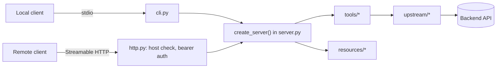

# Architecture

Paths are under `src/mcp_app/`.

| Path | Does |
|---|---|
| `cli.py` | Reads settings, starts stdio by default, or HTTP with `--http` |
| `server.py` | Builds an `MCPServer` with every tool and resource |
| `tools/` | One module per tool: typed parameters, an output model, annotations, and the handler |
| `resources/` | Resources and their data |
| `http.py` | The Starlette app: health, protected resource metadata, auth, and the MCP endpoint |
| `auth/` | Static token and JWT verifiers |
| `upstream/` | Clients for backend APIs, with timeouts and response validation |
| `config.py`, `log.py` | Settings from the environment, and JSON logs on stderr |

## Key behaviors

- **Both protocol eras:** clients on the stateless 2026-07-28 protocol and clients on the older `initialize` handshake are both served, over stdio and HTTP.
- **Stateless HTTP:** no session state is kept between requests, so it scales horizontally with no session store.
- **Safe defaults:** HTTP binds to localhost, checks the `Host` header against DNS rebinding, and won't start until you pick an auth mode.
- **Clean stdout:** logs go to stderr as JSON, so they never corrupt stdio messages.
- **Schemas from types:** each tool's input schema comes from its type hints, and its output schema from the model in `Annotated[CallToolResult, Model]`.
